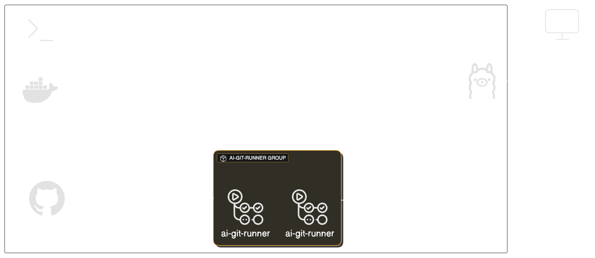

# Ollama-AI-Agent


## Setup Ollama

Visit https://ollama.com/

- Docker ( with GPU Acceleration )
- Standalone Ollama CLI tools ( Better for MAC )
- Plenty of models to choose from
    - For this demo `qwen2.5-coder` will be used
    - Library https://ollama.com/library/qwen2.5-coder

```
ollama:
    image: ollama/ollama:latest
    ports:
      - 11434:11434
    volumes:
      - ollama:/root/.ollama
    
    container_name: ollama
    tty: true
    restart: unless-stopped
    deploy:
       resources:
         reservations:
           devices:
           - driver: nvidia
             capabilities: ["gpu"]
             count: all
    runtime: nvidia
    
```

## Setup OpenWebUI

- Frontend to interact with Ollama models
- Docker is much easier to setup

```
openwebui:
    image: ghcr.io/open-webui/open-webui:main
    container_name: openwebui
    volumes:
      - open-webui-data:/app/backend/data
    depends_on:
      - ollama
    ports:
      - 1111:8080
    environment:
      - 'OLLAMA_BASE_URL=http://localhost:11434'
      - 'WEBUI_SECRET_KEY='
    extra_hosts:
      - host.docker.internal:host-gateway
    network_mode: bridge
    restart: unless-stopped
    
```

## Setting up PR Agent with QODO

Qodo ( formerly Codium ) is a PR agent that can help with code reviews and merging pull requests. 

It's available at https://www.qodo.ai/products/qodo-merge/


### How to use Qodo (PR Agent)?

#### Using CLI ( Local )

Requires installing `pr-agent>=0.2.7` in your python environment.

```
python3 -m pr_agent.cli \
  --pr_url <link to your pr> \
  "ask" \
  "write me a poem about this PR"
```
#### Using Docker ( Local )
```
docker run --rm -it --network host --env-file <env file> 
        codiumai/pr-agent:latest --pr_url <link to your pr>
```

Fill up .env files to use github api token and other necessary details relevant for local ollama deployment.

#### Using GitHub Actions ( Production )

## Setting up Git Runner

- Follow the instructions from github
  - You need organization account to setup self hosted git runners
- Conveinent to have containerized Git Runner. Deploy locally from docker compose for local testing.
- Runner should have access to ollama server. Essentially they all should be in the same network.


## Overview



High-level architecture of the Ollama-AI-Agent setup, including Ollama, OpenWebUI, CLI/Docker PR Agent App.

## Extra stuff
### Continue - A VSCode Extenstion

- https://marketplace.visualstudio.com/items?itemName=Continue.continue
- Configure VSCode to use the Continue extension for auto completion, chat etc


